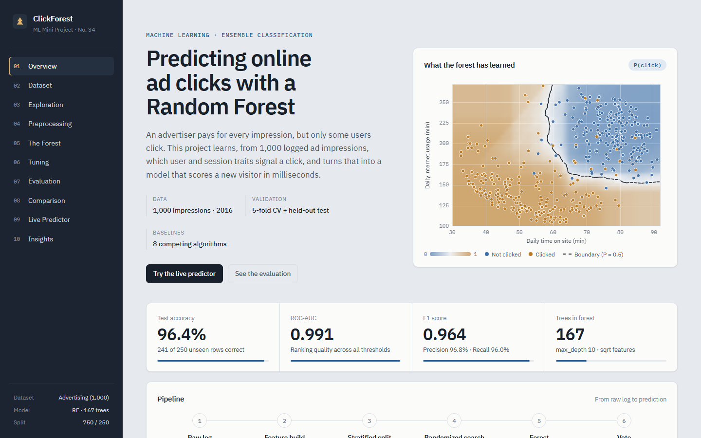
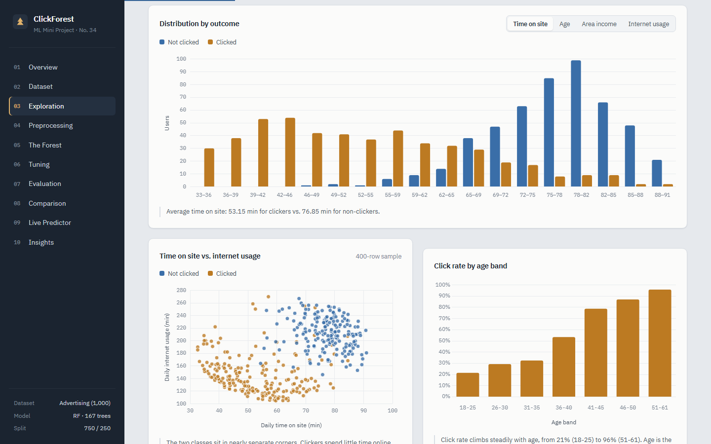
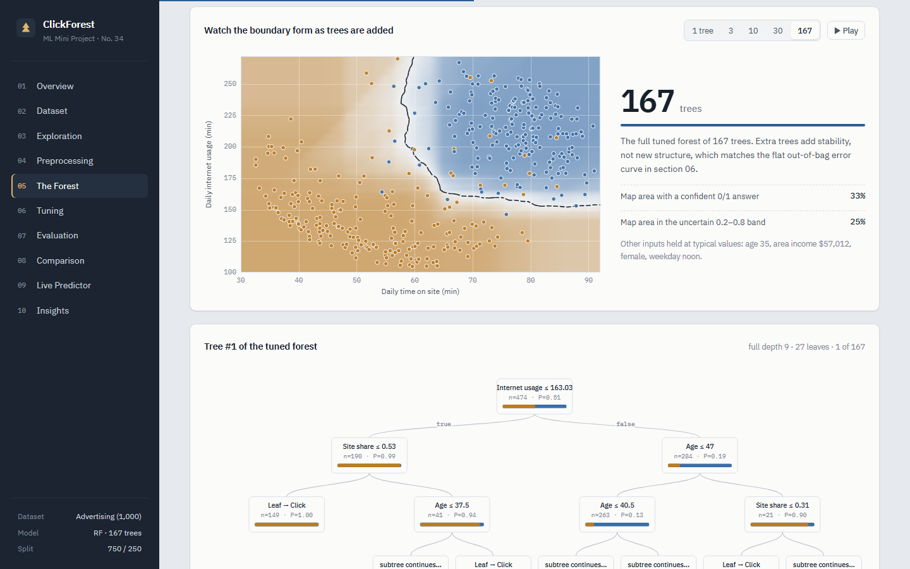
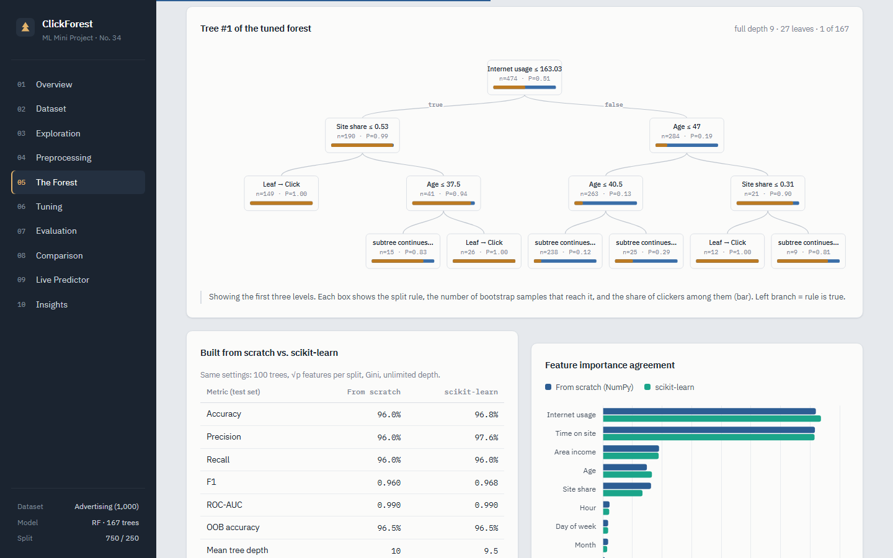
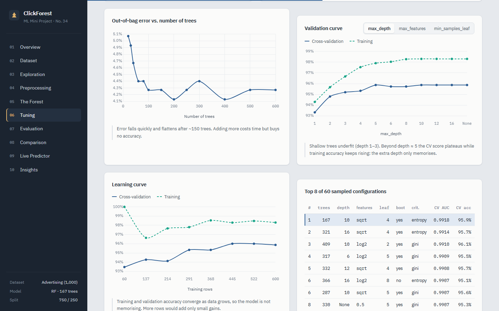
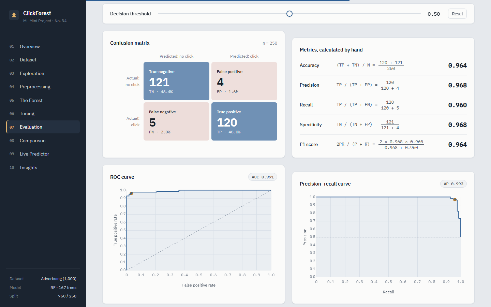
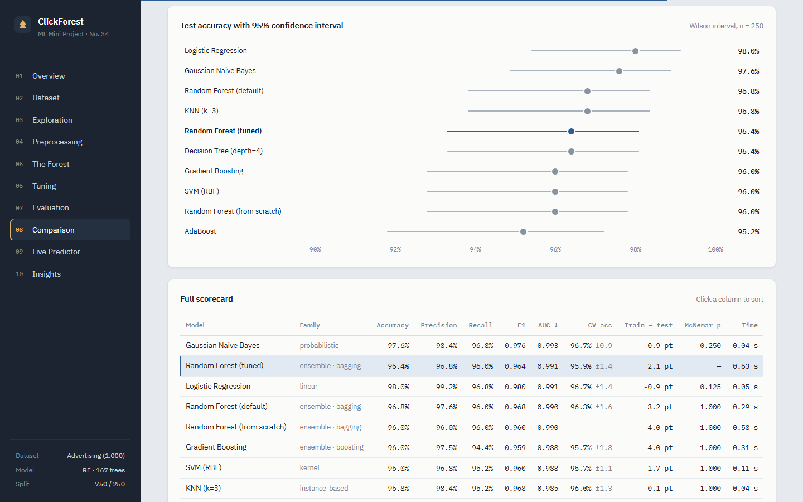
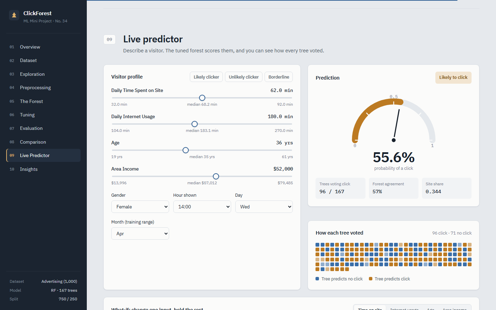
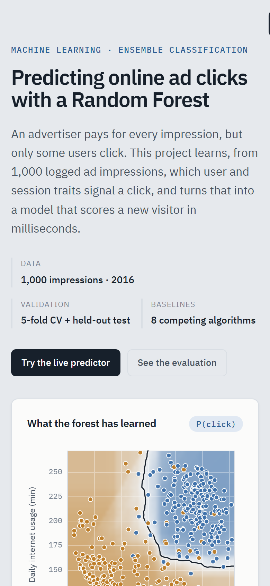

# ClickForest: Predicting Online Ad Clicks with Random Forest

A Random Forest classifier that predicts whether a user will click an online ad, plus an interactive dashboard that
explains every step: data, preprocessing, a from-scratch implementation, tuning, evaluation, model comparison, and a
live predictor.

> **ML Mini Project No. 34**: *Predict online ad clicks using Random Forest* · A.Y. 2025-26



## Results

Measured on 250 held-out users the model never saw during training or tuning:

| Accuracy | Precision | Recall | F1 | ROC-AUC |
|:---:|:---:|:---:|:---:|:---:|
| **96.4%** | 96.8% | 96.0% | 0.964 | **0.991** |

The final model has 167 trees, `max_depth=10`, `max_features="sqrt"` and `min_samples_leaf=4`. It was chosen by a
randomized search over 60 configurations with 5-fold stratified cross-validation (300 fits).

## Highlights

- **Random Forest from scratch:** CART trees with Gini splits, bootstrap sampling, random feature subsets,
  out-of-bag scoring and feature importance, in NumPy only. It matches scikit-learn: 99.2% prediction
  agreement and the same OOB accuracy (96.5%).
- **Leak-free preprocessing:** one `FeatureBuilder` transformer covers outlier capping (IQR), timestamp
  decomposition and a ratio feature. It is refit inside every cross-validation fold.
- **Honest comparison against eight algorithms**, with 95% confidence intervals and McNemar significance tests.
  Logistic Regression scores 98.0% vs the forest's 96.4%, but the gap is 4 rows out of 250 and not
  statistically significant (p = 0.125). The analysis explains why.
- **Interactive dashboard** (Flask + vanilla JS + Chart.js), with every chart driven by the real model output:
  - an animated decision surface
  - the boundary forming as trees are added
  - a threshold slider that updates the confusion matrix and hand-worked metrics
  - per-tree voting in the live predictor
- **Jupyter notebook and a 10-page report** covering every grading criterion.

## Screenshots

| | |
|:---:|:---:|
|  |  |
| **Exploration:** distributions, usage scatter, click rate by age | **The forest:** watch 1 → 167 trees smooth the decision boundary |
|  |  |
| **Tree #1:** the top levels of a real tree, plus scratch vs scikit-learn | **Tuning:** OOB error, validation and learning curves |
|  |  |
| **Evaluation:** threshold slider, confusion matrix, manual metric calculation | **Comparison:** accuracy with 95% CIs and full scorecard |



<p align="center"></p>

## Quick start

```bash
pip install -r requirements.txt
python app/app.py          # open http://127.0.0.1:5000
```

On Windows you can simply double-click **`run.bat`**. A trained model is included in `artifacts/`. To retrain
everything (about a minute):

```bash
python -m ml.train
```

## Dataset

The public *Advertising* click dataset: 1,000 ad impressions, 10 columns, no missing values, and a balanced target
(500 clicks / 500 non-clicks).

| Feature | Use |
|---|---|
| Daily Time Spent on Site, Daily Internet Usage, Age, Area Income | numeric inputs (IQR-capped) |
| Male | binary input |
| Timestamp | → Hour, Day of Week, Month |
| *Site Share* | engineered: time on site ÷ internet usage |
| Ad Topic Line, City, Country | dropped: near-unique identifiers |

## Key findings

- **Light internet users click.** Users online less than 150 min/day click 99% of the time; users online
  200+ min/day click 7% of the time.
- **Short visits click.** Visitors spending under 60 min on the site click 96% of the time; 75+ min, 9%.
- **Older users and lower-income areas click more.** Users aged 45+ click 91% of the time vs 25% for under-30s.
- **Timing and gender carry no signal.** Hour, weekday and month have near-zero permutation importance.

## Project structure

```
data/advertising.csv          dataset
ml/features.py                FeatureBuilder: preprocessing + feature engineering
ml/scratch_forest.py          decision tree + Random Forest from scratch (NumPy)
ml/train.py                   training, tuning, evaluation, comparison → artifacts/
artifacts/                    model.joblib + results.json
notebook/                     full analysis notebook
report/Project_Report.docx    written report (+ figures/)
app/                          Flask dashboard (fonts and Chart.js bundled, works offline)
docs/screenshots/             images used in this README
```

## Grading criteria coverage

| Criterion | Notebook | Dashboard |
|---|---|---|
| Dataset understanding | §1 | 02 Dataset |
| Preprocessing | §3 | 04 Preprocessing |
| Manual algorithm implementation | §4 (worked Gini split, scratch forest) | 05 The Forest |
| Algorithm application | §5 | 05 / 06 |
| Parameter tuning | §6 | 06 Tuning |
| Evaluation + manual calculation | §7 | 07 Evaluation |
| Comparison / analysis | §9 | 08 Comparison |
| Visualisation | §2, §6–9 | throughout |
| Interpretation | §10 | 10 Insights |

## Tech stack

Python · NumPy · pandas · scikit-learn · SciPy · Flask · Chart.js · Matplotlib / seaborn · Jupyter

## Author

**Prathmesh Sadaphule**: Machine Learning Mini Project, A.Y. 2025-26
